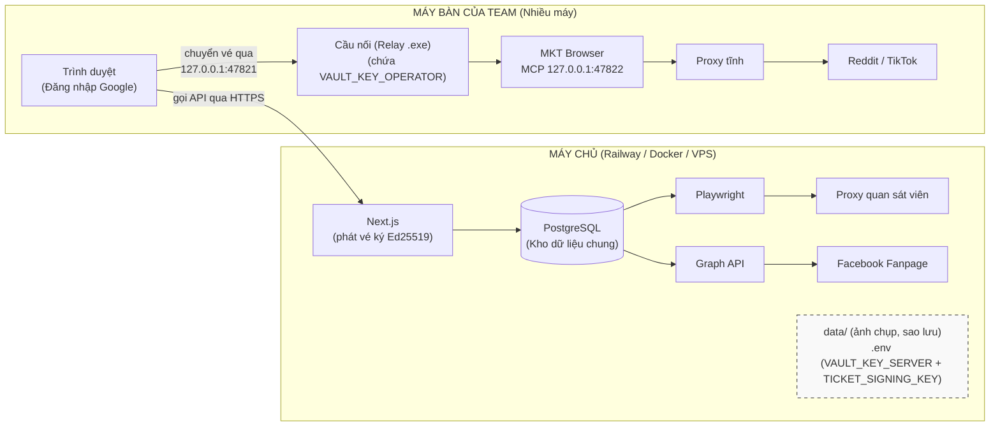
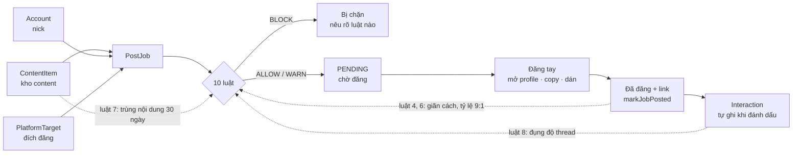

# Kiến trúc hệ thống

**Updated:** 30 August 2026

Tài liệu này trả lời: hệ thống **chạy ở đâu**, **tin ai**, **phụ thuộc gì**, và **hỏng thì hỏng
thế nào**. Code nằm ở đâu thì tra [codebase-summary.md](codebase-summary.md); thuật ngữ tra
[domain-glossary.md](domain-glossary.md).

---

## Release/consolidation boundaries — 30 August 2026

- **Trusted proxy:** the Web service resolves client IPs only from an explicitly configured,
  validated proxy-header/CIDR policy. Untrusted forwarding headers are ignored; rate-limit keys do
  not silently collapse every operator behind one proxy.
- **Database-backed rate limits:** Better Auth limits are persisted in PostgreSQL and exercised by
  racing workers. A local green test is not a production observation until the deployed service is
  checked with two distinct client addresses.
- **Durable spent-ticket journal:** Relay ticket use is append/validate/replay-protected across clean
  restart and forced termination. Invalid journal state is fail-closed; it never falls back to an
  in-memory replay guard.
- **One-seat boundary:** the CloakBrowser licence is consumed on the operator machine, never by the
  server. The server issues scoped tickets; the local Relay holds operator secrets and the Browser
  owns profile data. One account maps to one static proxy, managed profile, and Relay device.
- **Readiness/provenance:** `/api/healthz` is an unauthenticated, bounded readiness signal for the
  Web deployment and reports database/release checks. `emit-release-provenance.cjs` attests a clean
  Browser source tree, but neither signal is a signature, vendor assertion, or identity-isolation
  evidence.
- **Lane separation:** the MKTTool Web deployment does not require the Browser five-artifact tuple.
  P4a can ship independently; P4b remains the Browser/Relay/engine contract. `G2-IDENTITY` is FAIL
  on the recorded licensed-engine collisions, so this architecture makes no stealth or identity-
  isolation claim. Lane C is closed because there is no CloakBrowser channel.

## 1. Hình dung tổng thể

**Mô hình phân tán (Team nhiều người).**
- **Máy chủ** chạy trên mạng thật (Railway/VPS bằng Docker), lo tính toán, bộ luật, dò shadowban, đăng Fanpage và quản lý toàn bộ dữ liệu chung.
- **Operator device:** runs the normal browser, **Relay**, and MKT Browser. Relay decrypts operator
  secrets and calls the authenticated MKT Browser MCP endpoint. Windows x64 is the only v1, demo,
  pilot, and rollout platform; macOS is deferred to MKB-07 behind the same trust boundaries.

Ba đường ra internet đi qua **ba IP khác nhau và không được lẫn**: nick đi bằng proxy tĩnh của chính nó (từ máy bàn), bộ dò đi bằng proxy quan sát viên (từ máy chủ), Graph API đi bằng IP máy chủ. Lẫn đường nào cũng phá đúng thứ nó đang bảo vệ.

TikTok belongs to the browser-profile path, not the posting pipeline. TikTok accounts use the same
account → static proxy → managed profile → Relay device ownership boundary as Reddit, but their
current action is human-controlled profile use only. These ownership and routing controls do not
prove browser identity isolation. `TARGET_PLATFORMS` still excludes TikTok, so
the queue, posting rules, warmup, and publishing paths do not silently activate for it.

> **Current W02 boundary:** production Relay constructs `MktBrowserAdapter` and calls the owned
> contract on loopback port `47822` by default. The path remains
> `Web → Relay → authenticated MCP → MKT Browser`; operator keys stay in Relay and profiles/cookies
> stay on the operator device. There is no MultiZen provider or configuration fallback.

> **Current managed boundary:** contract version `4` advertises idempotent create, atomic launch,
> managed-profile locking, operation diagnostics, and no MCP profile deletion. Relay v16 preserves
> ticket `jti` as
> `operationId`, calls `launch_managed_profile`, and accepts the result only when correlation matches.
> The Browser persists and reads back the requested proxy before Chromium starts; a running session
> is returned only when its active proxy matches. Ordinary direct launch, delete, export, and
> proxy/fingerprint edits are blocked for managed profiles.

> **Token and health boundary:** the token discovered from the current Windows user data root grants
> profile management only. It cannot list or call page-read, page-control, cookie, or raw-CDP tools,
> and the build issues no page-control token. Relay `/health` reports live Browser, app, engine,
> contract, and capability state for this PC. Historical device enrollment is not readiness;
> list/create/launch stop until the current runtime is operational.

> **Setup conflict boundary:** the combined installer persists its read-only conflict detector beside
> MKT Browser. `get_runtime_info` adds `local-install-ready-v1` only when that detector verifies the
> expected Browser and Relay ownership, ports `47821`/`47822`, MultiZen process state, and startup
> entries. The Relay-first `/setup` journey no longer consumes this Browser capability: Relay PC
> registration and identity-workspace handoff can complete without distributing Browser. Browser
> profile operations retain their managed-capability checks, so this UX separation does not grant
> Browser readiness, rollout approval, or identity-isolation approval.

> **P0 rollout boundary:** automated proxy-egress, lease-journal, and technical readiness checks are green, but
> `license-capacity-v1` is not advertised because vendor start/heartbeat/end state is not connected
> to the journal. Packaged Relay restart and real disposable-VM power-cycle recovery have sanitized,
> hash-bound evidence; real proxy/DNS/WebRTC completion, the remaining human login/input sessions,
> second-PC setup, vendor sidecar/schema integration, and the canary remain open.

> **“Relay” does not mean an edge proxy here.** It exposes no public tunnel, target-forwarding API,
> or proxy pool. It verifies recipient-bound tickets, opens operator-domain secrets locally, and calls
> MKT Browser on loopback. Account traffic leaves only through that account's bound static proxy; a
> failure stops the operation instead of selecting another proxy, profile, device, or account.

## 2. Vòng đời một bài đăng — và vòng phản hồi nuôi bộ luật

Đường liền là một bài đi từ trái sang phải. **Ba đường đứt mới là thứ đáng nhớ**: chúng chạy
ngược về bộ luật, và chúng là lý do bộ luật ngày càng chính xác thay vì đứng yên.

Hệ quả trực tiếp: **quên bấm "Đã đăng" là cắt cả ba đường ngược cùng lúc.** Job nằm mãi ở
`PENDING`, không có `Interaction` nào được ghi, và với bộ luật thì bài đó **chưa từng tồn tại** —
nick khác đụng đúng thread ấy sẽ được cho qua, giãn cách đếm sai, tỷ lệ 9:1 đếm thiếu. Không có
thông báo lỗi nào cho tình huống này, vì đứng từ trong app nhìn ra thì không có gì hỏng cả. Đó là
lý do nút "Đã đăng" được đặt ngay tại thẻ nhắc việc ở trang Hôm nay chứ không bắt đổi trang.

Cùng lý do đó, content gõ thẳng ở trang xếp lịch vẫn phải được lưu thành `ContentItem` thật:
luật 7 so bài mới với kho trong 30 ngày, content không vào kho thì mỗi bài viết thẳng lại xóa
một mẩu trí nhớ của luật ấy. Lưu **sau** khi chấm luật, để bài không tự so trùng với chính nó.

## 3. Ranh giới tin cậy

| Ranh giới | Cách canh |
|---|---|
| **Mạng** | Nghe mọi card mạng từ 05/08/2026 — cờ `-H 127.0.0.1` đã bỏ vì công cụ phải phục vụ cả team. Hàng rào chuyển hẳn sang tầng đăng nhập |
| **Đăng nhập** | Google OAuth (Better Auth) + danh sách trắng `ALLOWED_EMAILS`. Kiểm ở **mọi request** chứ không chỉ lúc tạo tài khoản — gỡ email khỏi `.env` rồi khởi động lại là mất quyền ngay, kể cả đang mở sẵn tab |
| **Trang** | `src/proxy.ts` (Next 16 đổi tên từ `middleware.ts`) chặn mọi trang trước khi nó kịp hỏi database; chưa đăng nhập thì chuyển hướng về `/login`. **Bắt buộc `runtime: "nodejs"`** — mặc định edge không nạp được Prisma và mọi trang thành 500. Kiểm phiên thật chứ không ngó cookie, để người vừa bị gỡ khỏi `ALLOWED_EMAILS` mất quyền ngay |
| **Lối vào** | Mọi export trong file `"use server"` và mọi method trong `route.ts` phải bọc `guardedAction`/`guardedRoute`. Gác nằm ở **chữ ký**, không nằm trong thân hàm, nên không nhánh nào bỏ qua được; `guarded-entry-points.test.ts` kiểm bằng hình dạng mã nguồn và `NOT_YET_GUARDED` phải rỗng |
| **Bí mật của nick** | `requireNickOwner`: máy chủ chỉ cấp **vé mã hóa** chứa mật khẩu/OTP cho đúng chủ nick hoặc ADMIN. Chặn ở **tầng dữ liệu**, không phải ẩn nút. Tầm nhìn thông tin thì **không chia**: luật đụng độ thread phải nêu đúng tên nick của đồng nghiệp mới dùng được. Mật khẩu thật chỉ xuất hiện ở Cầu nối trên máy của đúng người đó. |
| **Proxy assignment** | `updateAccount` compares the normalized `proxyId` with the stored value and calls `requireAdmin(actor)` only when the proxy actually changes. OPERATOR retains karma, status, voice, and browser-profile ID edits; only ADMIN receives the editable proxy control, while the server remains the real enforcement point. |
| **Route handler trong `api/`** | Đối chiếu `Origin`/`Host` (`same-origin-guard.ts`) — chặn trang khác trong cùng trình duyệt gọi sang |
| **Credential** | Mã hóa AES-256-GCM trước khi ghi. 8 cột ở 5 bảng, khai trong `encrypted-field-registry.ts` kèm **vùng khóa** từng cột (`server` = máy chủ mở được, `operator` = 3 cột credential của `Account`). Test đọc thẳng `schema.prisma` để bắt cột `*Enc` khai thiếu **và** khai lệch vùng so với dấu `vault:*` trong schema. Mặc định của `encryptCredential` là khóa `server`; cột vùng operator phải truyền `loadVaultKey("operator")` rõ ràng |
| **Khóa mã hóa** | Hai khóa hoàn toàn tách biệt: `VAULT_KEY_SERVER` nằm ở máy chủ (giữ proxy + token FB), và `VAULT_KEY_OPERATOR` nằm ở cầu nối trên máy nhân viên (giữ bí mật nick). Chiếm được máy chủ cũng không thể mở nổi mật khẩu nick nào vì khóa không hề tồn tại ở đó. |
| **Bí mật lọt ra log** | Mật khẩu proxy chỉ tồn tại dạng trần trong lời gọi phát vé; token Facebook đi qua `redactTokens()` trước mọi thông báo lỗi |
| **Nhật ký** | `AuditLog` ghi mọi thao tác nhạy cảm: mở profile, xem credential, ghi đè luật, đăng Fanpage, phát vé ký |
| **Assignment audit** | Proxy and browser-profile ID changes append ID-only before → after values to `ACCOUNT_UPDATED` inside the account-write transaction. Proxy endpoints and credentials are never recorded. |

### Relay device lifecycle boundary

| Path | Authority and ordering | Local data result |
|---|---|---|
| Repair/reinstall | No server state change | Preserve Relay identity, Browser profiles, tokens, and MultiZen |
| Normal uninstall | Remove only owned binaries, processes, shortcuts, autostart, and firewall state | Preserve all identity-bearing data, including a pre-existing Relay |
| Planned ADMIN retirement | Revoke and unpin on the server first; issue a short-lived signed authorization bound to `deviceId + publicKey + finalizationPublicKey`; validate recipient proof; persist a durable signed completion receipt | Remove Relay keys/config/grant state; retain non-secret rollback/tombstone guards; preserve Browser and MultiZen data |
| Owner cleanup after revocation | Begin, complete, and finalize only the signed-in owner's exact already-revoked record; recheck access under the transaction advisory lock at every server entry point; never unpin accounts | Use the same signed recipient proof, durable receipt, and local cleanup/finalization protocol; preserve Browser and MultiZen data |
| Lost/unreachable PC | Revoke immediately and rotate `VAULT_KEY_OPERATOR` when exposure is plausible | No remote-wipe claim; local Relay and Browser state may remain |

ADMIN retains active retirement and account unpinning. Owner cleanup cannot revoke an active PC,
change ownership, or restore a revoked identity. The local device ID/public-key match and Relay v11+
floor remain mandatory. Setup offers `RECOVER` for an exact owned revoked binding; other conflicts
remain `ADMIN`. A pending protected receipt routes to recovery without proving owner match; server
authorization still applies. Successful finalization closes Relay; restart and Setup create a fresh
identity through normal enrollment. Validation/deployment status lives in the
[owner-cleanup checkpoint](development-roadmap.md#relay-owner-cleanup---8-september-2026).

Relay writes a DPAPI-protected receipt before crossing the local deletion boundary. While that
receipt exists, startup enters retirement recovery before key generation or enrollment and exposes
only health, receipt-authorized idempotent cleanup retry, and signed finalization. A non-secret
rollback-floor marker and legacy tombstone remain, so older Relay artifacts cannot recreate an
identity while recovery is pending. Each retirement has a one-use
finalization signing key whose public half is sealed into the local receipt. The encrypted private
seed is erased when the server stores the durable completion receipt, so normal ticket-key rotation
cannot strand recovery and cannot mint another completion afterward. Browser profile deletion belongs
to an independent in-app Browser lifecycle because profile cookies are not Relay-owned. It is absent
from MCP, requires a typed full-profile-id confirmation, refuses active lifecycle work, and deletes
only the owned profile directory plus its database row. Retryable pending state reports partial
cleanup without touching Relay, device credentials, the Browser token, settings, or MultiZen.

### Browser startup coordination candidate - 8 September 2026

Normal packaged Windows Browser launch acquires the canonical-root instance lock before opening
settings, tokens, SQLite, or lease state. Browser checks the fixed current-user Relay installation;
only a verified owned executable may be started. Conflicts fail closed without killing processes,
rewriting configuration, issuing tickets, or repairing ownership. Relay stays an independent
process, not a supervised service or a background retirement-restart loop.

A usable tray changes manager close into hide; explicit Quit starts once-only profile/control
cleanup and cancels pending companion work, leaving Relay available for vault operations. Windows
session-end enters the same cleanup path, without promising completion before forced OS termination.
Tray failure preserves normal visible-window close behavior. Development, disposable roots, and
compatibility smoke do not enter this lifecycle.

The combined installer makes Browser the sole owned login entry and restores standalone Relay
startup on uninstall if Relay is retained. Only exact-target owned shortcuts may change. Existing
device identity, secrets, profile data, Relay v16, and signed authorization remain unchanged.

Web profile setup reads Relay health and profile inventory, verifies the measured create-profile
version floor (currently 13), and evaluates Browser runtime separately. Retry is read-only; unknown
or malformed responses never become Ready or an unsupported update claim. Operator copy uses
reviewed states, not raw runtime errors. Source is under verification; the frozen installer tuple
is unchanged and a new candidate needs separate acceptance before delivery. See the
[startup checkpoint](development-roadmap.md#single-entry-browser-startup---8-september-2026).

### Compatibility-set release authority

The Windows installer pins the Ed25519 root public key copied from the verified physical ceremony
evidence. The offline root signs delegation and revocation statements; the delegated key signs
compatibility manifests. R2 stores immutable bytes but grants no release authority. Private root
backups, their passphrase, and the DPAPI-protected delegated private key never enter either repository,
CI, Railway, or R2.

Protected local state records the highest accepted manifest sequence, a secure-store rollback floor,
and exactly one retained rollback sequence. Relay, MKT Browser, the control contract, and the pinned
engine activate as one tuple. Interrupted activation must converge after restart to either the entire
new tuple or the entire retained tuple; mixed-version execution is forbidden. Release metadata cannot
authorize a downgrade. The only monotonic exception is a one-use ADMIN rollback authorization naming
the retained sequence at or above the secure-store floor.

## 4. Nơi dữ liệu nằm

| Thứ | Ở đâu | Sao lưu thế nào | Mất thì sao |
|---|---|---|---|
| Nick, proxy, content, job, tương tác, nhật ký | Postgres (`mkttool_dev` dưới máy dev, Postgres của Railway trên máy chủ) | Hai lớp: **app tự đẩy lên Cloudflare R2 mỗi đêm** + `npm run db:backup:remote` (người quản trị kéo về máy mình, và chạy trước mỗi deploy đổi cấu trúc DB). Sao lưu ổ đĩa Railway **cố ý không dùng** — đòi gói Pro, mà bản sao lại nằm cùng tài khoản với bản gốc. Dưới máy dev: `npm run db:backup` | Mất toàn bộ lịch sử → bộ luật mù, cho qua bài lẽ ra phải chặn |
| Mật khẩu, TOTP secret, token Facebook | cùng database, dạng ciphertext | như trên | – |
| `VAULT_KEY_SERVER` / `VAULT_KEY_OPERATOR` | `.env` | **Password manager, thủ công** | Mất khóa = mất vĩnh viễn credential của vùng đó. Không có đường khôi phục |
| Ảnh chụp lúc dò | `data/screenshots/` | không | Chỉ mất bằng chứng hình ảnh; bản ghi kết luận vẫn còn |
| Bản sao lưu | Bucket R2 (lượt tự động) + `data/backups/` của máy quản trị | – | Bản sao **cố ý không nằm cùng nhà với bản gốc**: trong container `data/backups/` là ổ tạm, mất theo mỗi lần deploy |
| File khóa lượt dò | `data/health-check.lock` | – | Trạng thái máy đang chạy, không phải dữ liệu dự án |
| Profile/cookie/browser settings của nick | Kho cục bộ của app profile trên đúng máy operator; target ở Application Support trên Mac hoặc LocalAppData trên Windows | Hiện chưa có sao lưu tập trung; plan MKT Browser chỉ cho export mã hóa và import có kiểm soát | Mất máy có thể mất phiên đăng nhập/profile; thu hồi vé không xóa từ xa dữ liệu đã nằm trên ổ đĩa. Local storage is not identity-isolation proof |

Toàn bộ `data/` và `.env` đều nằm trong `.gitignore`. Repo **không bao giờ** chứa credential.

## 5. Phụ thuộc bên ngoài và cách chúng hỏng

| Phụ thuộc | Dùng để | Hỏng thì biểu hiện | Xử lý đã cài sẵn |
|---|---|---|---|
| **MKT Browser** (authenticated local MCP, default `127.0.0.1:47822`) | Open browser profiles and apply their static proxies | HTTP 401/403, desktop app stopped, contract/engine/CPU mismatch, or missing WebRTC containment | One transport re-handshake is allowed; proxy/tool failures remain fail-closed. MKB-02 enforces managed controls and token separation. MKB-03 now also requires exact per-engine outbound UDP protection before any proxied Windows launch; the installer owns elevation and stable runtime paths. BrowserLeaks/runtime-update retest, engine pinning, signed updates/rollback, and installer recovery remain gates; Mac arm64 belongs to MKB-07 |
| **Proxy tĩnh** (nhà cung cấp) | Đường ra của từng nick | Egress probe unavailable, empty, malformed, or different from the assigned route | Managed launch fails closed before success. Real in-browser equality plus DNS/WebRTC evidence remains a rollout gate rather than an assumption from the probe alone |
| **Proxy quan sát viên** | Dò shadowban | Chưa nhập thì `npm run health` dừng ngay từ đầu | Cố ý dừng: dò bằng IP nhà còn tệ hơn không dò |
| **HTML `old.reddit.com`** | Nguồn dữ liệu dò shadowban + karma | Reddit đổi giao diện → parser hỏng | Hỏng thì kết luận **`ERROR` ("Không dò được")**, tuyệt đối không bao giờ là `HEALTHY`. `npm run health:smoke` đối chiếu Reddit thật |
| **Facebook Graph API** | Đăng Fanpage | Token hết hạn/bị thu hồi | Chấm sức khỏe token **trước khi gọi mạng**; Facebook từ chối thì ghi `tokenValid=false` ngay |
| **Chromium của Playwright** | Phiên trình duyệt sạch để dò | Chưa cài | `npx playwright install chromium` |

Không phụ thuộc nào có phương án dự phòng tự động, và đó là chủ ý: mỗi lần hỏng đều **dừng và
nói rõ**, không đoán tiếp. Cả bốn cái chết thầm lặng nguy hiểm nhất — mở profile thiếu proxy, dò
bằng IP nhà, kết luận "khỏe" khi thật ra không đọc được, đăng bằng token đã chết — đều bị chặn
bằng một đường dừng hẳn chứ không phải một cảnh báo.

## 6. Kiến trúc phần mềm — ba quyết định định hình mọi thứ

**1. Mỗi luật an toàn là một hàm thuần `(ctx: RuleContext) => RuleVerdict`.**
Toàn bộ việc hỏi database gom ở `rule-context-builder.ts`. Thêm luật mới = thêm một file + một
dòng trong `rules-engine.ts`. Test được không cần database. Đây là lý do phần giá trị nhất của
dự án cũng là phần dễ sửa nhất.

**2. The browser-profile runtime sits behind `AntidetectAdapter`.** MKTTool retains the MKT Browser
and AdsPower implementations for server/test selection, while production profile actions go through
Relay. Relay deliberately constructs `MktBrowserAdapter`, discovers the bearer token from MKT
Browser's Windows data root on demand, accepts `mktBrowserToken` only as a development override, and
uses `mktBrowserUrl` only as an explicit loopback override. It does not inspect retired provider or
configuration names. When MKT Browser exposes `atomic-launch-v1`, Relay uses the provider-owned
persist/verify/launch operation; the two-call fallback is restricted to older builds where the tool
is absent.

**3. Ràng buộc nghiệp vụ ép ở tầng database, không ở tầng UI.** `antidetectProfileId @unique`,
`proxyId @unique`, `@@unique([platform, username])` — quy tắc "1 nick = 1 proxy = 1 profile cấu hình"
không lách được kể cả khi viết sai code ứng dụng. UI chỉ giải thích lỗi cho dễ hiểu; nó không biến
cấu hình thành bằng chứng cô lập danh tính.

Hệ quả của cả ba: phần khó thay đổi nhất (schema) giữ thứ quan trọng nhất (ràng buộc sở hữu và
đường ra),
phần dễ thay đổi nhất (file luật) giữ thứ hay đổi nhất (kinh nghiệm vận hành).

## 7. Vì sao không chọn cái khác

| Đã chọn | Thay vì | Lý do |
|---|---|---|
| Máy bàn, một tiến trình | VPS + Docker + microservices | Antidetect browser là app desktop. 1 người dùng, 1 máy — mọi lớp hạ tầng thêm vào đều là chi phí không đổi lấy gì |
| Postgres + Prisma | SQLite một file | SQLite từng đúng khi chỉ có 1 người dùng 1 máy, và đã chạy như vậy tới 04/08/2026. Đổi khi chốt làm web chung cho team — một file trên một máy không phục vụ được 5-6 người ở 5-6 nơi |
| Server actions của Next.js | REST/GraphQL API riêng | Không có client thứ hai. API tách ra chỉ để tự gọi mình là công vô ích |
| Reddit qua trình duyệt | Reddit API | API free cấm mục đích thương mại; API thương mại ~$12k/tháng |
| Facebook Pages qua Graph API | Tự động hóa trình duyệt | Miễn phí, hợp lệ, không bao giờ bị khóa vì vi phạm chính sách tự động hóa |
| Facebook Group đăng tay | Groups API | Meta khai tử `publish_to_groups` từ 04/2024. Không tool nào làm được nữa |
| Proxy tĩnh tính theo IP | Proxy dân cư tính theo GB | Bản cũ ước tính ~5,4 triệu/tháng tiền băng thông; IP đổi liên tục còn phá ràng buộc 1 nick : 1 IP |
| Playwright cho bộ dò | Dò qua chính antidetect browser | Dò phải đi bằng IP khác và phiên sạch. Dùng lại profile của nick là tự nhìn mình trong gương |

Chi tiết bối cảnh từng quyết định ở [project-overview-pdr.md](project-overview-pdr.md),
[plan gốc](../plans/260801-2030-multi-account-posting-console/plan.md) và
[plan MKT Browser](../plans/260810-0244-mkt-browser-noi-bo/plan.md).

## 8. Đường lớn lên nếu quy mô đổi

Không làm bây giờ. Ghi lại để lần sau khỏi tranh luận lại từ đầu:

| Nếu | Phải đổi gì |
|---|---|
| Nhiều người dùng chung một bản | **Đã xong** — hệ thống hiện tại đã là web chung. Database chuyển sang Postgres, đăng nhập bằng Google OAuth, phân quyền ADMIN/OPERATOR, và kho danh tính đã tách hai vùng khóa với cầu nối (Relay) giải mã độc lập trên máy trạm. |
| Chạy 24/7 không ai ngồi máy | Cần hàng đợi việc thật (không phải bảng `PostJob`) + máy luôn bật. Nhưng xem lại mục "không làm" ở PDR trước đã |
| Trên 20 nick | Antidetect browser trên máy bàn hết chỗ; cần VPS có GUI hoặc nhiều máy. Chi phí proxy tăng tuyến tính |
| Thêm nền tảng mới | Thêm giá trị vào `platform-family.ts`; đích chưa có bộ đăng tự động sẽ tự rơi vào nhắc việc đăng tay — không im lặng biến mất |
