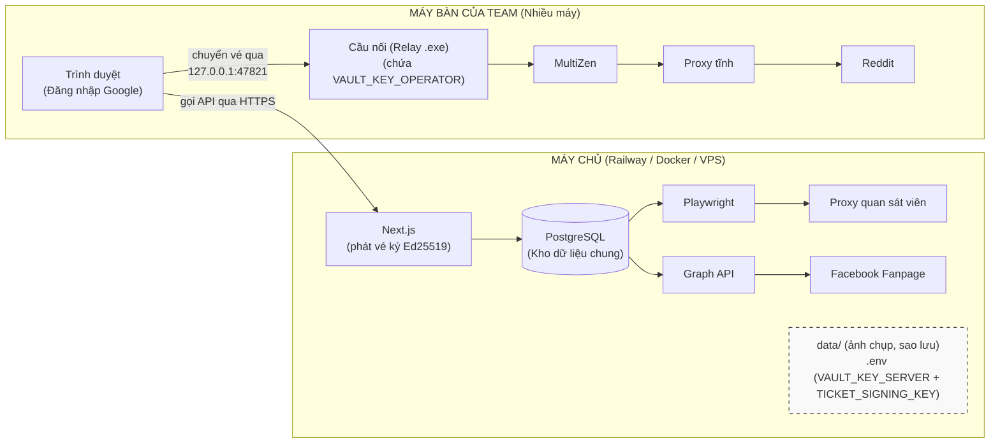
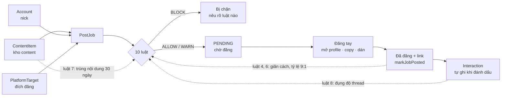

# Kiến trúc hệ thống

**Cập nhật:** 06/08/2026

Tài liệu này trả lời: hệ thống **chạy ở đâu**, **tin ai**, **phụ thuộc gì**, và **hỏng thì hỏng
thế nào**. Code nằm ở đâu thì tra [codebase-summary.md](codebase-summary.md); thuật ngữ tra
[domain-glossary.md](domain-glossary.md).

---

## 1. Hình dung tổng thể

**Mô hình phân tán (Team nhiều người).**
- **Máy chủ** chạy trên mạng thật (Railway/VPS bằng Docker), lo tính toán, bộ luật, dò shadowban, đăng Fanpage và quản lý toàn bộ dữ liệu chung.
- **Máy bàn** của nhân viên chạy Trình duyệt và **Cầu nối (Relay)** để mở trình duyệt ẩn danh (MultiZen) và giải mã mật khẩu nick nội bộ.

Ba đường ra internet đi qua **ba IP khác nhau và không được lẫn**: nick đi bằng proxy tĩnh của chính nó (từ máy bàn), bộ dò đi bằng proxy quan sát viên (từ máy chủ), Graph API đi bằng IP máy chủ. Lẫn đường nào cũng phá đúng thứ nó đang bảo vệ.

## 2. Vòng đời một bài đăng — và vòng phản hồi nuôi bộ luật

Đường liền là một bài đi từ trái sang phải. **Ba đường đứt mới là thứ đáng nhớ**: chúng chạy
ngược về bộ luật, và chúng là lý do bộ luật ngày càng chính xác thay vì đứng yên.

Hệ quả trực tiếp: **quên bấm "Đã đăng" là cắt cả ba đường ngược cùng lúc.** Job nằm mãi ở
`PENDING`, không có `Interaction` nào được ghi, và với bộ luật thì bài đó **chưa từng tồn tại** —
nick khác đụng đúng thread ấy sẽ được cho qua, giãn cách đếm sai, tỷ lệ 9:1 đếm thiếu. Không có
thông báo lỗi nào cho tình huống này, vì đứng từ trong app nhìn ra thì không có gì hỏng cả. Đó là
lý do nút "Đã đăng" được đặt ngay tại thẻ nhắc việc ở trang Hôm nay chứ không bắt đổi trang.

Cùng lý do đó, content gõ thẳng ở trang xếp lịch vẫn phải được lưu thành `ContentItem` thật:
luật 7 so bài mới với kho trong 30 ngày, content không vào kho thì mỗi bài viết thẳng lại xóa
một mẩu trí nhớ của luật ấy. Lưu **sau** khi chấm luật, để bài không tự so trùng với chính nó.

## 3. Ranh giới tin cậy

| Ranh giới | Cách canh |
|---|---|
| **Mạng** | Nghe mọi card mạng từ 05/08/2026 — cờ `-H 127.0.0.1` đã bỏ vì công cụ phải phục vụ cả team. Hàng rào chuyển hẳn sang tầng đăng nhập |
| **Đăng nhập** | Google OAuth (Better Auth) + danh sách trắng `ALLOWED_EMAILS`. Kiểm ở **mọi request** chứ không chỉ lúc tạo tài khoản — gỡ email khỏi `.env` rồi khởi động lại là mất quyền ngay, kể cả đang mở sẵn tab |
| **Trang** | `src/proxy.ts` (Next 16 đổi tên từ `middleware.ts`) chặn mọi trang trước khi nó kịp hỏi database; chưa đăng nhập thì chuyển hướng về `/login`. **Bắt buộc `runtime: "nodejs"`** — mặc định edge không nạp được Prisma và mọi trang thành 500. Kiểm phiên thật chứ không ngó cookie, để người vừa bị gỡ khỏi `ALLOWED_EMAILS` mất quyền ngay |
| **Lối vào** | Mọi export trong file `"use server"` và mọi method trong `route.ts` phải bọc `guardedAction`/`guardedRoute`. Gác nằm ở **chữ ký**, không nằm trong thân hàm, nên không nhánh nào bỏ qua được; `guarded-entry-points.test.ts` kiểm bằng hình dạng mã nguồn và `NOT_YET_GUARDED` phải rỗng |
| **Bí mật của nick** | `requireNickOwner`: máy chủ chỉ cấp **vé mã hóa** chứa mật khẩu/OTP cho đúng chủ nick hoặc ADMIN. Chặn ở **tầng dữ liệu**, không phải ẩn nút. Tầm nhìn thông tin thì **không chia**: luật đụng độ thread phải nêu đúng tên nick của đồng nghiệp mới dùng được. Mật khẩu thật chỉ xuất hiện ở Cầu nối trên máy của đúng người đó. |
| **Route handler trong `api/`** | Đối chiếu `Origin`/`Host` (`same-origin-guard.ts`) — chặn trang khác trong cùng trình duyệt gọi sang |
| **Credential** | Mã hóa AES-256-GCM trước khi ghi. 8 cột ở 5 bảng, khai trong `encrypted-field-registry.ts` kèm **vùng khóa** từng cột (`server` = máy chủ mở được, `operator` = 3 cột credential của `Account`). Test đọc thẳng `schema.prisma` để bắt cột `*Enc` khai thiếu **và** khai lệch vùng so với dấu `vault:*` trong schema. Mặc định của `encryptCredential` là khóa `server`; cột vùng operator phải truyền `loadVaultKey("operator")` rõ ràng |
| **Khóa mã hóa** | Hai khóa hoàn toàn tách biệt: `VAULT_KEY_SERVER` nằm ở máy chủ (giữ proxy + token FB), và `VAULT_KEY_OPERATOR` nằm ở cầu nối trên máy nhân viên (giữ bí mật nick). Chiếm được máy chủ cũng không thể mở nổi mật khẩu nick nào vì khóa không hề tồn tại ở đó. |
| **Bí mật lọt ra log** | Mật khẩu proxy chỉ tồn tại dạng trần trong lời gọi phát vé; token Facebook đi qua `redactTokens()` trước mọi thông báo lỗi |
| **Nhật ký** | `AuditLog` ghi mọi thao tác nhạy cảm: mở profile, xem credential, ghi đè luật, đăng Fanpage, phát vé ký |

## 4. Nơi dữ liệu nằm

| Thứ | Ở đâu | Sao lưu thế nào | Mất thì sao |
|---|---|---|---|
| Nick, proxy, content, job, tương tác, nhật ký | Postgres (`mkttool_dev` dưới máy dev, Postgres của Railway trên máy chủ) | Hai lớp: **app tự đẩy lên Cloudflare R2 mỗi đêm** + `npm run db:backup:remote` (người quản trị kéo về máy mình, và chạy trước mỗi deploy đổi cấu trúc DB). Sao lưu ổ đĩa Railway **cố ý không dùng** — đòi gói Pro, mà bản sao lại nằm cùng tài khoản với bản gốc. Dưới máy dev: `npm run db:backup` | Mất toàn bộ lịch sử → bộ luật mù, cho qua bài lẽ ra phải chặn |
| Mật khẩu, TOTP secret, token Facebook | cùng database, dạng ciphertext | như trên | – |
| `VAULT_KEY_SERVER` / `VAULT_KEY_OPERATOR` | `.env` | **Password manager, thủ công** | Mất khóa = mất vĩnh viễn credential của vùng đó. Không có đường khôi phục |
| Ảnh chụp lúc dò | `data/screenshots/` | không | Chỉ mất bằng chứng hình ảnh; bản ghi kết luận vẫn còn |
| Bản sao lưu | Bucket R2 (lượt tự động) + `data/backups/` của máy quản trị | – | Bản sao **cố ý không nằm cùng nhà với bản gốc**: trong container `data/backups/` là ổ tạm, mất theo mỗi lần deploy |
| File khóa lượt dò | `data/health-check.lock` | – | Trạng thái máy đang chạy, không phải dữ liệu dự án |

Toàn bộ `data/` và `.env` đều nằm trong `.gitignore`. Repo **không bao giờ** chứa credential.

## 5. Phụ thuộc bên ngoài và cách chúng hỏng

| Phụ thuộc | Dùng để | Hỏng thì biểu hiện | Xử lý đã cài sẵn |
|---|---|---|---|
| **MultiZen** (MCP cục bộ) | Mở profile antidetect, đẩy proxy | HTTP 401 (thiếu bearer token), hoặc app khởi động lại giữa chừng | Bắt tay lại tự động; đẩy proxy hỏng thì **không mở profile** |
| **Proxy tĩnh** (nhà cung cấp) | Đường ra của từng nick | Đẩy vào profile vẫn "thành công" dù proxy đã chết | Không tự phát hiện được — phải mở `ipinfo.io` kiểm IP sau mỗi lần mở profile mới |
| **Proxy quan sát viên** | Dò shadowban | Chưa nhập thì `npm run health` dừng ngay từ đầu | Cố ý dừng: dò bằng IP nhà còn tệ hơn không dò |
| **HTML `old.reddit.com`** | Nguồn dữ liệu dò shadowban + karma | Reddit đổi giao diện → parser hỏng | Hỏng thì kết luận **`ERROR` ("Không dò được")**, tuyệt đối không bao giờ là `HEALTHY`. `npm run health:smoke` đối chiếu Reddit thật |
| **Facebook Graph API** | Đăng Fanpage | Token hết hạn/bị thu hồi | Chấm sức khỏe token **trước khi gọi mạng**; Facebook từ chối thì ghi `tokenValid=false` ngay |
| **Chromium của Playwright** | Phiên trình duyệt sạch để dò | Chưa cài | `npx playwright install chromium` |

Không phụ thuộc nào có phương án dự phòng tự động, và đó là chủ ý: mỗi lần hỏng đều **dừng và
nói rõ**, không đoán tiếp. Cả bốn cái chết thầm lặng nguy hiểm nhất — mở profile thiếu proxy, dò
bằng IP nhà, kết luận "khỏe" khi thật ra không đọc được, đăng bằng token đã chết — đều bị chặn
bằng một đường dừng hẳn chứ không phải một cảnh báo.

## 6. Kiến trúc phần mềm — ba quyết định định hình mọi thứ

**1. Mỗi luật an toàn là một hàm thuần `(ctx: RuleContext) => RuleVerdict`.**
Toàn bộ việc hỏi database gom ở `rule-context-builder.ts`. Thêm luật mới = thêm một file + một
dòng trong `rules-engine.ts`. Test được không cần database. Đây là lý do phần giá trị nhất của
dự án cũng là phần dễ sửa nhất.

**2. Antidetect browser nằm sau một interface.** `AntidetectBrowserAdapter` có hai cài đặt
(MultiZen, AdsPower), đổi bằng một dòng `.env`. Không có lời gọi MultiZen nào rò ra ngoài
`lib/antidetect/`.

**3. Ràng buộc nghiệp vụ ép ở tầng database, không ở tầng UI.** `antidetectProfileId @unique`,
`proxyId @unique`, `@@unique([platform, username])` — quy tắc "1 nick = 1 proxy = 1 vân tay"
không lách được kể cả khi viết sai code ứng dụng. UI chỉ giải thích lỗi cho dễ hiểu.

Hệ quả của cả ba: phần khó thay đổi nhất (schema) giữ thứ quan trọng nhất (ràng buộc danh tính),
phần dễ thay đổi nhất (file luật) giữ thứ hay đổi nhất (kinh nghiệm vận hành).

## 7. Vì sao không chọn cái khác

| Đã chọn | Thay vì | Lý do |
|---|---|---|
| Máy bàn, một tiến trình | VPS + Docker + microservices | Antidetect browser là app desktop. 1 người dùng, 1 máy — mọi lớp hạ tầng thêm vào đều là chi phí không đổi lấy gì |
| Postgres + Prisma | SQLite một file | SQLite từng đúng khi chỉ có 1 người dùng 1 máy, và đã chạy như vậy tới 04/08/2026. Đổi khi chốt làm web chung cho team — một file trên một máy không phục vụ được 5-6 người ở 5-6 nơi |
| Server actions của Next.js | REST/GraphQL API riêng | Không có client thứ hai. API tách ra chỉ để tự gọi mình là công vô ích |
| Reddit qua trình duyệt | Reddit API | API free cấm mục đích thương mại; API thương mại ~$12k/tháng |
| Facebook Pages qua Graph API | Tự động hóa trình duyệt | Miễn phí, hợp lệ, không bao giờ bị khóa vì vi phạm chính sách tự động hóa |
| Facebook Group đăng tay | Groups API | Meta khai tử `publish_to_groups` từ 04/2024. Không tool nào làm được nữa |
| Proxy tĩnh tính theo IP | Proxy dân cư tính theo GB | Bản cũ ước tính ~5,4 triệu/tháng tiền băng thông; IP đổi liên tục còn phá ràng buộc 1 nick : 1 IP |
| Playwright cho bộ dò | Dò qua chính antidetect browser | Dò phải đi bằng IP khác và phiên sạch. Dùng lại profile của nick là tự nhìn mình trong gương |

Chi tiết bối cảnh từng quyết định ở [project-overview-pdr.md](project-overview-pdr.md) và
[plan.md](../plans/260801-2030-multi-account-posting-console/plan.md).

## 8. Đường lớn lên nếu quy mô đổi

Không làm bây giờ. Ghi lại để lần sau khỏi tranh luận lại từ đầu:

| Nếu | Phải đổi gì |
|---|---|
| Nhiều người dùng chung một bản | **Đã xong** — hệ thống hiện tại đã là web chung. Database chuyển sang Postgres, đăng nhập bằng Google OAuth, phân quyền ADMIN/OPERATOR, và kho danh tính đã tách hai vùng khóa với cầu nối (Relay) giải mã độc lập trên máy trạm. |
| Chạy 24/7 không ai ngồi máy | Cần hàng đợi việc thật (không phải bảng `PostJob`) + máy luôn bật. Nhưng xem lại mục "không làm" ở PDR trước đã |
| Trên 20 nick | Antidetect browser trên máy bàn hết chỗ; cần VPS có GUI hoặc nhiều máy. Chi phí proxy tăng tuyến tính |
| Thêm nền tảng mới | Thêm giá trị vào `platform-family.ts`; đích chưa có bộ đăng tự động sẽ tự rơi vào nhắc việc đăng tay — không im lặng biến mất |
