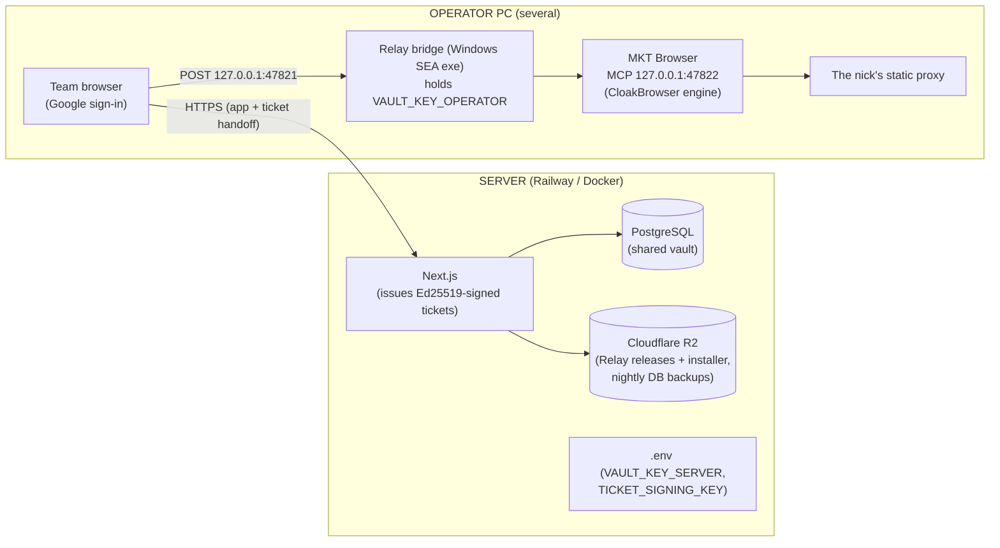

# System architecture

**Updated:** 31 October 2026

This document answers: where the system **runs**, what it **trusts**, what it **depends on**, and
**how it fails**. For where the code lives, see [codebase-summary.md](codebase-summary.md); for
vocabulary, [domain-glossary.md](domain-glossary.md).

---

## 1. Overview

- **The server** computes, stores, authorizes, and signs. It never opens an operator-zone secret:
  it issues sealed, recipient-bound tickets it cannot itself decrypt, and writes the audit trail.
- **The Relay bridge** runs on each operator PC, listens only on `127.0.0.1:47821`, verifies ticket
  signatures and replay protection, decrypts operator-zone secrets, applies the nick's proxy, and
  calls the authenticated MKT Browser MCP endpoint on loopback `47822`.
- **Profile data and cookies stay on the operator PC.** The server holds no browser data, and the
  browser-profile ID is meaningless without the machine that owns it — that is why every ticket
  routes to `Account.deviceId`, not to whoever pressed the button.

Account traffic leaves only through that account's bound static proxy. A proxy failure stops the
operation; it never selects another proxy, profile, device, or account.

> **"Relay" does not mean an edge proxy here.** It exposes no public tunnel, no target-forwarding
> API, no proxy pool. It verifies recipient-bound tickets, opens operator-domain secrets locally,
> and calls MKT Browser on loopback.

## 2. Trust boundaries

| Boundary | How it is guarded |
|---|---|
| **Network** | The web app listens on the platform's routing; the only local listener is the Relay on `127.0.0.1:47821`, which accepts loopback connections only |
| **Sign-in** | Google OAuth (Better Auth) + the `ALLOWED_EMAILS` allowlist, checked on **every request**, not only at sign-in. Removing an email takes effect immediately, even for an open tab |
| **Pages** | `src/proxy.ts` (Next 16 renamed `middleware.ts`) checks the real session against the allowlist before a page can query the database. Requires `runtime: "nodejs"` — the edge default cannot load Prisma, and every page would 500 |
| **Entry points** | Every export in a `"use server"` file and every method in a `route.ts` is wrapped by `guardedAction`/`guardedRoute`. The guard lives in the function signature, not the body, so no branch can skip it; `guarded-entry-points.test.ts` enforces the shape |
| **Nick secrets** | `requireNickOwner`: the server issues a sealed ticket containing the password/OTP only to the nick's owner or an ADMIN. Enforcement is at the data layer, not by hiding buttons. There is no second UI path that bypasses it |
| **Proxy vault** | ADMIN-only for add/edit/delete/bandwidth probes; liveness checks are cheap (KBs) and open to everyone |
| **Route handlers** | `POST` routes in `api/` compare `Origin` with `Host` (`same-origin-guard.ts`) — Next does this for server actions but not for route handlers |
| **Credentials** | AES-256-GCM before the database. Column→zone mapping lives in `encrypted-field-registry.ts`; a test reads `schema.prisma` and fails if a `*Enc` column is missing from the registry or declares the wrong `vault:*` zone |
| **Encryption keys** | Two fully separated zones: `VAULT_KEY_SERVER` on the server (proxy passwords, API tokens); `VAULT_KEY_OPERATOR` on operator PCs inside Relay (nick passwords, emails, TOTP). Keys live in environment variables / Relay config, never in the database |
| **Secrets in logs** | Passwords exist in plaintext only in the ticket-issuance call path on the operator PC; provider errors pass through token redaction before display or `AuditLog` |
| **Audit trail** | `AuditLog` records every sensitive action — credential reveal, profile launch, ticket issuance, key grant, revocation — with the actor and the receiving PC |

Trusted-proxy handling: client IPs are resolved only from an explicitly configured, validated
proxy-header/CIDR policy; untrusted forwarding headers are ignored, and rate-limit keys do not
silently collapse every operator behind one proxy. Better Auth rate limits are persisted in
PostgreSQL.

## 3. Ticket and relay boundary

The ticket is the only thing the server ever hands out to a device:

- **Ed25519 signature** over a recipient-sealed payload. The public key is derived from the seed;
  there is no way to configure a mismatched pair. Relay verifies the signature **before** decoding
  anything.
- **Sealed box**: one keypair per ticket → X25519 → HKDF → AES-256-GCM to the receiving PC's
  registered public key. The server stores a box it cannot open.
- **~30 seconds of life, single use.** The spent-ticket journal lives in the Relay, is appended and
  validated before the operation, and survives restart and forced termination. Invalid journal state
  fails closed; it never falls back to an in-memory guard.
- **Per-kind version floor.** Every ticket kind carries a minimum Relay version; the general
  security floor is 13, and profile create/launch require a newer floor because they need
  capabilities old builds cannot prove. An outdated Relay is told exactly that.
- **Rate limiting** on credential-reveal tickets caps how fast a stolen session could drain
  secrets; the audit log makes the attempt visible.

Relay device lifecycle:

| Path | Authority and ordering | Local data result |
|---|---|---|
| Repair/reinstall | No server state change | Preserve Relay identity and profiles |
| Normal uninstall | Remove only owned binaries, processes, shortcuts, autostart, firewall state | Preserve identity-bearing data |
| ADMIN retirement | Revoke and unpin on the server first; short-lived signed authorization bound to `deviceId + publicKey + finalizationPublicKey`; durable signed completion receipt | Remove Relay keys/config/grant state; preserve profile data |
| Owner cleanup after revocation | Begin/complete/finalize only the signed-in owner's exact already-revoked record; never unpin accounts | Same signed protocol; profiles preserved |
| Lost/unreachable PC | Revoke immediately; rotate `VAULT_KEY_OPERATOR` if exposure is plausible | No remote-wipe claim; local state may remain |

Revocation blocks new tickets immediately. It does not reach data already on the revoked PC's disk
— that gap is covered by rotating the operator key, not by pretending the disk was wiped.

Relay updates are **reinstall-only** since the self-update platform was removed on 31 October 2026:
an outdated Relay is directed to reinstall the current package from `/setup`. There is no signed
compatibility-update machinery, no sequence pinning, and no release-authority ceremony anymore.

## 4. Where data lives

| Thing | Where | Backed up | If lost |
|---|---|---|---|
| Nicks, proxies, audit log | Postgres (local dev DB / Railway Postgres) | Two layers: nightly app-managed dump to Cloudflare R2 + `npm run db:backup:remote` pulled by an admin. `npm run db:backup` for the local machine. Railway's own disk backups are deliberately unused: same account as the original is not a backup | Full vault history |
| Passwords, emails, TOTP seeds | Same database, as ciphertext | Same | The ciphertext survives; whether it is readable depends on the keys |
| `VAULT_KEY_SERVER` / `VAULT_KEY_OPERATOR` | Server `.env` / Relay config on each PC | **Password manager, manual** | Permanent loss of that zone's data. No recovery path, by design |
| Backups | R2 bucket (automatic) + admin's `data/backups/` | – | Deliberately **not** stored next to the original: inside the container `data/backups/` is ephemeral |
| Browser profile / cookies / login state | MKT Browser local storage on the owning PC | None centrally; device transfer is a gated MKT Browser capability | Losing the PC may lose the profile's logged-in sessions. Revocation does not erase the disk |

`data/` and `.env` are gitignored. The repository never contains credentials, and
`npm run ci:secret-scan` checks the tree.

## 5. External dependencies and how they fail

| Dependency | Used for | Failure mode | Built-in response |
|---|---|---|---|
| **MKT Browser** (authenticated local MCP, `127.0.0.1:47822`) | Create and open browser profiles, apply their static proxies | HTTP 401/403, desktop app stopped, contract/engine mismatch, missing WebRTC containment | Fail closed. Without a discoverable token, Relay can still reveal secrets but profile actions stop with a configuration error |
| **Static proxy provider** | Each nick's route to its platform | Liveness probe unavailable, or exit IP equals the operator's IP | Profile launch fails closed. The five probe verdicts (alive, dead, no IP change, country mismatch, uncheckable) each have distinct copy, and "not checked yet" is never rendered as healthy |
| **Cloudflare R2** | Relay/installer distribution; nightly backups | Download route unavailable; backup upload fails | The download page states what it looked for instead of pretending; a failed nightly backup is recorded as failed and surfaced on the workspace overview |
| **Google OAuth** | Sign-in | Client misconfiguration | The app refuses to start without the required auth variables rather than running unauthenticated |

No dependency has an automatic fallback, deliberately: each failure **stops and says so** instead
of guessing. The dangerous silent failures — a profile launched without its proxy, a "healthy"
verdict produced by a broken check, secrets revealed to the wrong machine — are all prevented by a
hard stop rather than a warning.

## 6. Software architecture — decisions that shape everything

**1. The browser-profile runtime sits behind an adapter boundary.** Production profile actions go
through Relay, which constructs `MktBrowserAdapter` against the owned MKT Browser contract on
loopback `47822`. `mktBrowserUrl` and `mktBrowserToken` in `relay-config.json` exist only as
explicit development overrides; retired provider names are not read as fallbacks. AdsPower remains
a secondary compatibility adapter for tests, not a rollout path.

**2. Tickets carry authorization; the database carries truth.** The server validates session,
ownership, and revocation at issuance; the Relay validates signature, version floor, and replay at
consumption. Neither side trusts the other's check, and each side's checks are independently
tested.

**3. Business constraints are enforced at the database layer.** `antidetectProfileId @unique`,
`proxyId @unique`, `@@unique([platform, username])` — the "1 nick = 1 proxy = 1 profile" rule
cannot be bypassed even by an application bug. The UI only explains violations in readable words.

**4. Account writes use optimistic concurrency.** Nick edit and owner/PC assignment forms carry the
record's `updatedAt` revision; a stale save is rejected whole, with no audit row and no rule
recheck. This bounds the two account write paths, not the whole app.

## 7. Why not the alternatives

| Chosen | Instead of | Reason |
|---|---|---|
| Postgres + Prisma | One-file SQLite | SQLite was correct for one user on one machine, until 04/08/2026. A file on one machine cannot serve 5-6 people in 5-6 places |
| Next.js server actions | A separate REST/GraphQL API | There is no second client. Splitting an API out to call it from the same app is ceremony |
| Plain `Dockerfile` | Provider-specific config | The same image must run on Railway, Render, Fly, or a VPS; lock-in is discovered on the day you want to leave |
| Static ISP proxies per IP | Rotating residential per GB | Rotating IPs change constantly, which breaks 1 nick : 1 IP by construction |
| Windows SEA Relay | A server-side browser controller | Profile data and the operator key must stay on the operator's machine; a server-driven browser would collapse both trust boundaries |

## 8. If scale changes

Not now. Recorded so the debate does not restart from zero:

| If | What changes |
|---|---|
| More people join | Allowlist and roles already exist; the work is operator onboarding, not architecture |
| Above ~20 nicks | Per-PC profile storage fills up; more machines, more Relay registrations. Proxy cost grows linearly |
| New platform added to the vault | Add the platform value and its account-field validation; browser-backed platforms inherit the full proxy/profile/PC/owner chain by construction |
| Posting ever returns | It is an owner decision that starts from git history, with its own acceptance criteria — and the boundaries in [project-overview-pdr.md](project-overview-pdr.md) apply |
