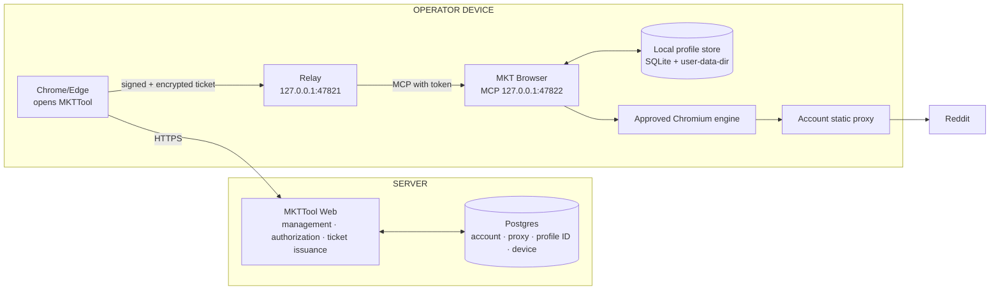
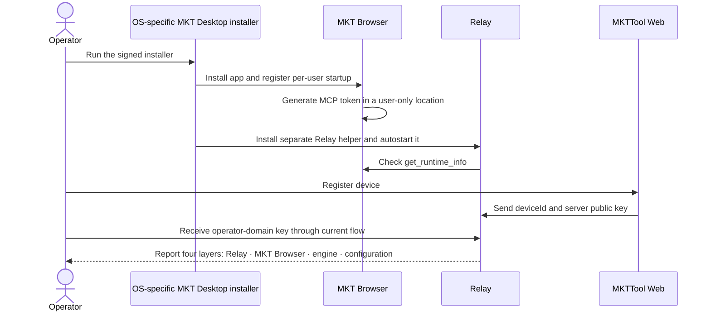
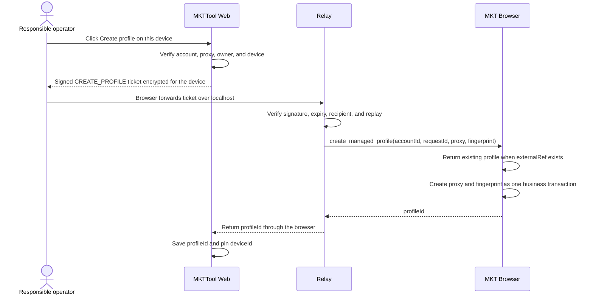
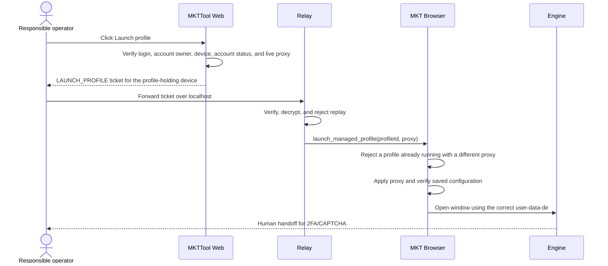
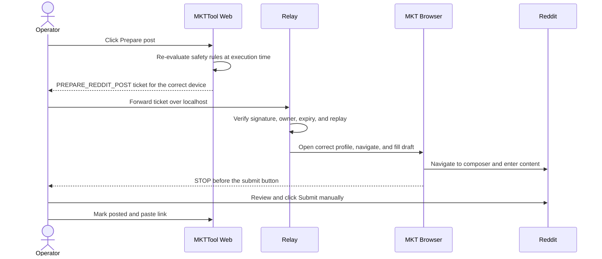
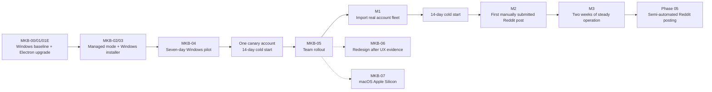

# MKT Browser — a dedicated MultiZen fork for MKTTool

**Direction approved:** 10 August 2026

**Status:** MKB-00 open · MKB-W01 Windows isolation verified · MKB-W02 internal clean break verified · Windows x64 is the primary platform for v1 · macOS Apple Silicon moves to MKB-07 after v1 · retain the MultiZen UX/UI in v1

**Status source:** [development-roadmap.md](../../docs/development-roadmap.md)

**Current architecture:** [system-architecture.md](../../docs/system-architecture.md)

> **Language decision (10 August 2026):** All implementation artifacts, product copy,
> documentation, tests, installers, and release material must be written in English. Direct chat
> with the project owner may remain in Vietnamese. This active specification has been translated
> before MKB-00 implementation; historical records remain unchanged.

> **MKB-00 evidence (10 August 2026):** Official MultiZen `v0.3.1` is pinned at
> `83c6898b2de3de1122b5fea88008fbbaa4677bff` in the separate `E:\MKTBrowser` checkout. The
> unmodified Windows x64 build, direct MCP contract, and current MKTTool adapter passed with only
> disposable profiles; failed proxy application remained fail-closed. MKB-00 is not complete: the
> correct-proxy test is still missing. The Apple Silicon half left this gate under the 10 August
> platform decision below and now belongs to MKB-07, where the verification runbook still applies.
> See the
> [source/license/engine inventory](../../../MKTBrowser/docs/mkb-00-source-license-engine-inventory.md)
> and [Apple Silicon verification runbook](../../../MKTBrowser/docs/mkb-00-apple-silicon-verification.md).

> **Windows-first exception (10 August 2026):** The project owner authorized MKB-W01 as a bounded
> product-isolation slice before the Apple Silicon half of MKB-00 can run. Windows now has the
> `MKT Browser` display identity, `com.mkttool.browser` application ID, fixed
> `%LOCALAPPDATA%\MKTTool\MKTBrowser\` root, no automatic legacy migration, and no callable
> MultiZen updater, heartbeat, or publish path. The compatible MCP/profile contract remains green.
> This exception does not pass MKB-00 or MKB-01 and does not authorize pilot, distribution, or
> rollout. Evidence is in
> [MKB-W01 Windows product isolation](../../../MKTBrowser/docs/mkb-w01-windows-product-isolation.md).

> **MKB-W02 verified (10 August 2026):** W01 remains the immutable Windows isolation checkpoint.
> W02 now owns the active first-party package, preload, MCP, adapter, and configuration identities,
> uses configurable default port `47822`, and removes the legacy fallback and inert settings. The
> packaged lifecycle passed through the updated MKTTool consumer while `7777` was independently
> occupied. Upstream attribution, history, profile/archive formats, and engine boundaries remain
> unchanged. See
> [MKB-W02 Windows evidence](../../../MKTBrowser/docs/mkb-w02-windows-internal-clean-break.md).

> **Platform decision (10 August 2026, supersedes the original macOS-first ordering):** v1 commits
> to **Windows x64 only**. macOS Apple Silicon moves out of v1 into MKB-07. This is a priority
> choice, not a hardware constraint: Mac machines are available, but the Windows technical slice is
> already verified end to end through W01, W02, and the repackaged Relay, while the macOS half still
> needs Apple Developer enrollment, notarization, a LaunchAgent helper, and Keychain storage, none of
> which is started or owned. No operator workflow depends on macOS today. The cost of this choice is
> that macOS evidence stays at zero for longer; the control is that the Relay and desktop code keep a
> shared core plus thin OS adapters, so MKB-07 adds a platform instead of reopening the core.

## One-line decision

Fork MultiZen into a dedicated desktop application provisionally named **MKT Browser**, with
**Windows x64** as the only committed platform for v1 and **macOS Apple Silicon** as the first
post-v1 platform, while keeping **MKTTool Web** and the **Relay** as independent components. The first version owns only
the application layer, operating workflow, and integrations. It does not fork Chromium, centralize
profiles or cookies on the server, or spend the critical path redesigning the MultiZen interface.

In operational terms:

- MKTTool Web decides **who may perform which action on which account**.
- The Relay verifies tickets and holds operator-domain secrets.
- MKT Browser stores profiles locally, applies the correct proxy and fingerprint, and opens the
  browser window.
- The approved Chromium engine renders websites. It is a separate dependency and is not
  automatically eligible for redistribution merely because the MultiZen application code uses MIT.

## 1. Why fork

MultiZen already provides the core behavior: it stores profiles, accepts MCP commands, and launches
Chromium. What MKTTool still needs is not a new antidetect algorithm but a **controlled workflow**:

1. Operators must not have to remember which profile belongs to which account.
2. Nobody should be able to apply the wrong proxy or open an unproxied profile from the desktop app.
3. A profile creation request interrupted halfway must not leave an undiscoverable orphan profile.
4. The Web application must be able to report which app and engine versions a device runs and
   whether they are compatible.
5. App or engine updates must not occur silently while identities are being warmed up or operated.
6. New-device installation, device transfer, and rollback must each have an explicit path.

A logo-only fork has no value. The fork succeeds only when operators work from MKTTool and rarely
need to open the desktop profile-management interface directly.

### How the target differs from current MultiZen usage

| Concern | Current MultiZen usage | MKT Browser target |
|---|---|---|
| Role | General-purpose profile manager | Dedicated MKTTool desktop component |
| Create profile | The Web app creates a profile and records its ID; after an interrupted request it searches by name | Bind `accountId` directly; a retry always returns the same existing profile |
| Launch profile | The Relay calls “update proxy” and then “launch” as two consecutive commands | The app performs one atomic operation; failed proxy application leaves no launch gap |
| Manual edit/launch | Users may still edit or open profiles directly in the app | Managed profiles lock proxy, fingerprint, deletion, and ordinary direct launch |
| Status | Primarily indicates whether MultiZen answers MCP | Reports app, engine, contract, capabilities, and the exact failing layer |
| Installation | MultiZen and Relay are installed separately and the MCP token is copied manually | One installation experience; the Relay discovers the local app and token automatically |
| Updates | App and engine change independently of the MKTTool workflow | Signed approved releases, pinned engine, staged pilot, and rollback |
| Device transfer | Export/import occurs outside the workflow and can leave two live copies | Transfer lock, recipient-encrypted bundle, and ADMIN audit trail |

The distinguishing feature is not a “more magical fingerprint.” MKT Browser takes MultiZen's
proven core and turns it into a device managed by MKTTool: difficult to misuse and practical for a
team to operate.

### v1 UX/UI decision

V1 **retains MultiZen's design language, layout, and components**. It changes only the required
name and logo and adds small functional signals: managed-profile badges, connection status, English
errors, and locked states for controls that could corrupt a proxy or fingerprint assignment. It does
not introduce a new design system, redraw the dashboard, or change familiar flows merely to make the
fork appear more bespoke.

A redesign may begin after the team has used the application and produced evidence about the parts
that are difficult to use. It is not on the fork's critical path.

## 2. Desired outcomes

### What operators see

- One signed Windows installer. macOS receives its notarized `.dmg` in MKB-07, after v1.
- A status page that clearly reports Relay, MKT Browser, engine, proxy, and version status.
- **Create profile on this device** creates exactly one profile, applies the proxy and fingerprint,
  and pins the account to the device.
- **Launch profile** opens the correct account; an error identifies the failing step and the required
  remedy.
- MKTTool-managed profiles cannot have their proxy or fingerprint edited or be deleted casually in
  the desktop app.
- MKTTool-managed profiles have no ordinary direct-launch button. A separate recovery path must
  warn operators instead of bypassing Web and Relay checks.
- CAPTCHA and 2FA remain human handoff steps inside the opened browser window.

### What administrators control

- Which device runs which app, engine, and control-contract versions.
- Which releases may be installed and which checksums and signatures must match.
- Staged updates rather than an all-at-once rollout.
- Audited device transfers that do not leave two simultaneously active profile copies.
- Revoking a device still blocks new tickets as it does now; the system makes no false promise to
  erase data remotely from a lost device.

### v1 measures

| Measure | Passing condition |
|---|---|
| Compatibility | The current list/create/update/launch/close flow works without changing ticket shape |
| Proxy safety | No launch path remains after proxy application fails or when a profile is already running with a different configuration |
| Installation usability | A person unfamiliar with MCP can install the product and reach ready status using only on-screen guidance |
| No orphans | Retrying create after a timeout returns the original profile rather than creating a second one |
| Data stability | Restarting, upgrading, or rolling back one version retains profile IDs, cookies, localStorage, and fingerprint seeds |
| Operations | One test device runs for at least seven days, followed by one real account completing first login and cold start |

## 3. Scope and non-goals

### Included in v1

- Fork the MultiZen desktop application into a separate repository.
- Make Windows x64 the primary and only committed platform.
- Keep the Relay and desktop code as a shared core plus thin OS adapters for paths, autostart, and
  secure storage, so macOS can be added in MKB-07 without reopening the core.
- Intel Mac and Linux are not on the critical path.
- Retain the MultiZen UX/UI with only minimal rebranding and required managed-profile states and
  locks.
- Keep MCP on loopback and retain compatibility with the tools MKTTool already calls.
- Add **MKTTool-managed profiles**.
- Add version, capability, diagnostics, and stable error-code reporting.
- Orchestrate proxy application and profile launch as one safe operation.
- Add an independent release channel, controlled updates, and rollback.
- Provide a copy-and-verify import path from existing MultiZen data without deleting the source.
- After the flow is stable, package MKT Browser and the Relay into one end-user installer.

### Excluded from v1

- Do not build or modify a Chromium antidetect binary.
- Do not ship, sign, or notarize a macOS artifact in v1, and do not buy Apple Developer access for
  it yet. Do not hardcode Windows assumptions into the shared core either; that is what makes MKB-07
  affordable.
- Do not redesign the UX/UI or create a custom design system in v1.
- Do not redistribute an engine binary unless its license permits redistribution.
- Do not cloud-sync profiles or cookies to MKTTool Web.
- Do not let the server call MKT Browser directly over the internet.
- Do not turn MKT Browser into a SaaS product or sell it externally.
- Do not add automatic CAPTCHA solving, auto-DM, reply hijacking, automated Group posting, or an
  unattended 24/7 bot.
- Do not add Reddit auto-posting to the fork. That remains Phase 05 and still requires human handoff.
- Do not support moving one identity back and forth between multiple devices. An account has exactly
  one profile-holding device at any moment.

## 4. Target architecture



### Boundaries that must remain distinct

| Component | May know | Must not know |
|---|---|---|
| MKTTool Web | account, encrypted proxy, profile ID, account owner, profile-holding device | local profile/cookies; operator-domain key |
| Relay | operator-domain key, device private key, ticket body after verification | whole-system database; authority to issue tickets |
| MKT Browser | local profiles, launch proxy, fingerprint seed, engine | account password/TOTP; vault key; MKTTool login session |
| Engine | current profile's user-data-dir and network traffic | Web administration access; Relay keys |

MKT Browser and the Relay may ship in **one installer**, but they remain two processes with two
responsibilities. The Relay retains the smallest cryptographic surface; the Electron UI must never
receive the operator-domain key.

## 5. Invariants

1. **Every Reddit account has exactly one static proxy, one fingerprint/profile, one profile-holding
   device, and one responsible operator at any moment.** One operator or device may hold multiple
   accounts; two accounts must not share a proxy or profile.
2. A failed proxy application prevents profile launch.
3. A profile already running with a different proxy must not silently reuse the old session.
4. The fingerprint seed generated for an account is immutable; import and device transfer preserve it.
5. The server only issues tickets and never has a key that can decrypt account secrets.
6. Every desktop port listens only on `127.0.0.1`; MCP always requires a bearer token.
7. MCP tokens, proxy passwords, and sensitive data never enter logs, errors, or telemetry.
8. The engine never updates silently. Every engine change passes pilot and fingerprint measurement.
9. Import never deletes source data. Cleanup occurs only after acceptance and an explicit human action.
10. A 2FA or CAPTCHA challenge stops for human handling; no automatic bypass path is added.
11. Uninstalling the app does not delete profiles by default. An uncleanly closed profile is reported
    at the next application start instead of being “repaired” by rebuilding the identity.

## 6. Contract between the Relay and MKT Browser

### Required compatibility layer

MKT Browser v1 retains the `/mcp` endpoint, bearer token, and the operations used by the current adapter:

| Need | Compatible tool |
|---|---|
| List profiles | `list_profiles` |
| List fingerprint options | `list_fingerprint_options` |
| Create profile | `create_profile` |
| Apply proxy | `update_profile` |
| Launch profile | `launch_profile` |
| Close profile | `close_profile` |

This lets the first fork build be verified with MKTTool before changing tickets, the database, or
authorization flows.

### MKTTool-specific extension

| Tool/capability | Purpose |
|---|---|
| `get_runtime_info` | Return app version, contract version, engine kind/version, and capabilities |
| `create_managed_profile` | Accept `externalRef = accountId` and `requestId`; safe retries return the existing profile |
| `launch_managed_profile` | In one operation: check state → apply proxy → verify configuration → launch |
| `reconcile_managed_profile` | Find the exact profile by `externalRef` after a timeout; never guess by a duplicated name |
| `diagnose_runtime` | Check engine, profile store, port, token, and proxy configuration without revealing secrets |

Every tool returns a **machine-readable error code**; the Relay translates it into English user copy.
MKTTool must not compare free-form upstream error strings.

The token used by the Relay may call only profile-management tools. Page-control tools such as
`navigate`, `click`, and `type` for Phase 05 require a separate capability or token and remain disabled
by default. Installing MKT Browser must not accidentally enable browser automation.

Example capability response:

```json
{
  "provider": "mkt-browser",
  "appVersion": "0.1.0",
  "contractVersion": 1,
  "profileSchemaVersion": 1,
  "engine": { "kind": "approved-external", "version": "..." },
  "capabilities": [
    "managed-profile-v1",
    "idempotent-create-v1",
    "atomic-launch-v1"
  ]
}
```

## 7. Data

### On the server

V1 reuses the current data:

- `Account.antidetectProfileId`: profile ID.
- `Account.deviceId`: profile-holding device.
- `Account.proxyId`: account's unique proxy.
- `RelayDevice`: device owner, ticket recipient key, and revocation state.

**Do not add a table during the compatibility phase.** The Relay reads version and capability data
directly from the current device. Store this data in Postgres only if the pilot demonstrates a real
need to track devices while they are offline; do not prebuild a table for a hypothetical need.

Device transfer is a post-pilot slice and must not reuse `Account.status`, which describes account
health. During MKB-05, add a minimal `ProfileTransfer` record containing the account, source device,
recipient device, status, and timestamps. An account may have only one active transfer; create and
launch routes refuse ticket issuance while the lock exists. The record retains orchestration evidence
only; it never stores a profile file, cookies, or decryption keys.

### On the operator device

Use a fixed operating-system-specific data root so changing Electron's `productName` does not make the
application look at an empty store:

| Operating system | Data root |
|---|---|
| macOS | `~/Library/Application Support/MKTTool/MKTBrowser/` |
| Windows | `%LOCALAPPDATA%\MKTTool\MKTBrowser\` |

```text
MKTBrowser/
├── data/
│   ├── profiles.db
│   ├── profiles/<profile-id>/
│   ├── mkt-control.db
│   └── migration-manifests/
├── engines/<engine>/<version>/
├── mcp-token
└── settings.json
```

`mkt-control.db` is the fork's auxiliary store; do not deeply modify upstream `profiles.db` schema.
Managed-profile metadata includes `externalRef`, `deviceId`, `createdAt`, `fingerprintSeedHash`, and
`lastAppliedProxyHash`. It contains no password, TOTP secret, or ticket contents.

Mac devices must use FileVault. Windows devices must use BitLocker or equivalent full-disk encryption.
A Chromium user-data-dir contains real sessions; do not falsely imply that SQLite encryption protects
all of it.

The device private key and operator-domain key belong to the Relay, not Electron. On macOS, store them
in Keychain and allow only the signed Relay helper to read them; on Windows, use a per-user secure
store such as DPAPI or Credential Manager. JSON files contain only non-sensitive metadata. The MKT
Browser MCP token remains separate, with `0600` permissions on macOS and per-user ACLs on Windows;
the Relay discovers it locally.

## 8. Primary flows

### 8.1 First installation on a device



The v1 team release is a signed Windows installer with per-user autostart. The Relay runs as a
separate process even when it ships in the same package. The macOS release — a native Apple Silicon
application signed with Developer ID, notarized, with the Relay as a LaunchAgent helper and no
Homebrew, `xattr`, or Terminal requirement — is specified in MKB-07 and is not a v1 deliverable.

During technical development, the app and Relay may be separate artifacts for diagnostics. Do not
hand them to the team until Windows has **one download and one installation flow**. If
the engine license prohibits bundling, the installer or app downloads it from the official source and
verifies its signature or checksum; the operator does not perform those steps manually.

### 8.2 Create an account profile



If the browser times out after the desktop has created the profile, reconciliation uses `externalRef`.
It never searches by name and never creates a second profile.

### 8.3 Launch a profile



During transition, the Relay prefers `launch_managed_profile`. Only when the capability is absent may
it fall back to the current `update_profile` followed by `launch_profile` sequence.

### 8.4 Update the app or engine

1. The Web app or status page reports an approved release; it does not close profiles automatically.
2. Refuse updates while a profile is open.
3. Snapshot metadata and databases and validate SQLite before changing anything.
4. Verify the package's digital signature and checksum.
5. Update the app; the engine has an independent version and changes only when the release manifest
   explicitly names a new version.
6. Run smoke tests: list → open test profile → cookie → proxy → close.
7. On failure, restore the prior app or engine snapshot. Never guess at a downgrade migration.

The engine progresses through **development → pilot device → team**. Do not automatically fetch the
latest engine every day: changing Chromium may change the measured fingerprint even if the profile ID
and seed remain constant.

### 8.5 Transfer a profile to another device

V1 uses a controlled manual flow:

1. An ADMIN creates a transfer from the old device to the new one. The Web app sets a **device-transfer
   lock**, so neither device can receive new create or launch tickets for the account.
2. Close the profile on the old device and confirm that no engine process holds its user-data-dir.
3. Export the profile with a one-time key and encrypt that key for the recipient device's public key.
   The manifest records profile ID, schema version, seed hash, and checksums.
4. Transfer the file outside MKTTool Web. The server stores only transfer evidence and never stores the
   file or plaintext.
5. The new device's Relay opens the key; MKT Browser imports into staging and verifies the profile ID,
   cookies, and seed.
6. An ADMIN accepts the import before repinning the account to the new device.
7. Launch from the Web app on the new device. On success, complete the transfer and leave the old copy
   locked during a recovery window.
8. After the recovery window, delete the old copy through a separate audited action. Cancelling midway
   leaves the pin on the old device and never allows two copies to be active.

Do not implement two-way sync. If the old device is lost before export, the system can revoke new
tickets but cannot promise to recover or remotely erase sessions already stored on that disk.

The recovery play for that day must be decided in advance rather than improvised: revoke the device so
it receives no further ticket, rotate the operator-domain key and every credential that device could
decrypt, unpin the account so it can be pinned to a replacement device, and accept that the identity
needs a fresh first login there with the cold-start risk that implies. Decide before the pilot whether
an identity that loses its profile is re-logged in or retired. That is a calm decision now and a
panicked one later.

### 8.6 Import existing MultiZen profiles

- Run only when both MultiZen and MKT Browser are closed.
- When the MKT Browser store is empty, offer to **copy**, never move automatically.
- Copy into a staging directory; validate the database, profile count, and checksums before an atomic
  rename.
- Preserve profile IDs and seeds and write a migration manifest.
- Retain the old MultiZen directory until acceptance and explicit user cleanup.
- Do not support reverse synchronization; all post-import actions occur in only one application.

The server vault currently has no real Reddit accounts, so the lowest-risk route is to finish the
pilot before creating the real profile fleet. Import still matters for development test profiles and
future upstream upgrades.

### 8.7 Future Phase 05 — prepare a post, with a human final submission

The fork does not automatically enable Phase 05. Only after M3 passes may the semi-automated flow use
the desktop where the real browser session lives:



- Do not place the session lock on Railway. The browser session is on the operator device, so the lock
  by `profileId` belongs in MKT Browser.
- Page-control tools use a different token or capability from profile management and are enabled only
  after Phase 05 is implemented.
- A 2FA or CAPTCHA challenge or a Reddit UI change stops in the real window. Never bypass it or click
  the final submit button automatically.
- A new ticket kind declares its own `MIN_RELAY_VERSION_BY_KIND`. Do not raise minimum versions for
  existing tickets when their shape has not changed.

The original Phase 05 plan predates the Railway deployment and is a historical record. Implementation
must use this flow and the living roadmap as the current sources of truth; automation and CDP must not
move back to the server.

## 9. Repository structure and upstream strategy

MKT Browser belongs in a separate repository, not inside MKTTool:

```text
mkt-browser/
├── apps/desktop/                # Electron main + renderer
├── packages/mcp-server/         # compatible tools
├── packages/profile-manager/    # SQLite + user-data-dir
├── packages/cdp-driver/         # engine control
├── packages/managed-contract/   # MKTTool version, schema, and error codes
├── packages/diagnostics/        # engine/proxy/WebRTC/fingerprint checks
├── resources/licenses/          # MIT notice + dependency licenses
└── .github/workflows/           # test, build, SBOM, signing, release
```

Git uses explicit remotes and branches:

- `upstream/master`: original MultiZen source; never push project commits there.
- `origin/main`: approved MKT Browser work.
- Each upstream intake occurs in a dedicated branch and passes contract, migration, and fingerprint
  acceptance before entering `main`.

Prefer additive modules and configuration over deep edits across upstream packages. Any unavoidable
upstream modification needs a test that names the MKTTool invariant absent from upstream.

## 10. License, engine, and release

MultiZen application code uses MIT and may be used, modified, and distributed while retaining its
copyright notice and license. [MIT source](https://raw.githubusercontent.com/multizenteam/multizen-browser/master/LICENSE).

However, the current bootstrap path downloads CloakBrowser from its official release channel. The
current CloakBrowser binary license treats compiled binaries separately from the MIT wrapper: it
allows internal use while restricting modification, repackaging, and redistribution, and the latest
major may require a subscription:

- [MultiZen ChromiumBootstrap](https://github.com/multizenteam/multizen-browser/blob/master/apps/desktop/src/main/ChromiumBootstrap.ts)
- [CloakBrowser Binary License](https://github.com/CloakHQ/CloakBrowser/blob/main/BINARY-LICENSE.md)

Therefore each release must pass these gates:

1. Approve the exact engine and version and the terms governing **internal use**.
2. Do not include a non-redistributable engine binary in the MKT Browser installer. Download directly
   from its official channel or use another approved agreement.
3. Retain NOTICE and license text for every component.
4. Generate an SBOM and run license checks for each release.
5. Use Developer ID, hardened runtime, and notarization on macOS and code signing on Windows. A
   checksum does not replace source authentication.

Apple identifies Developer ID as the mechanism Gatekeeper uses to identify developers distributing
outside the Mac App Store; notarization scans the signed package and issues a Gatekeeper ticket:

- [Apple — Signing your apps for Gatekeeper](https://developer.apple.com/developer-id/)

Upstream includes macOS build and installation paths, but its README currently recommends `xattr -cr`
to bypass warnings for an unsigned DMG. That is acceptable only for developer testing, not for the
employee installation experience:

- [MultiZen — macOS installation and cross-platform CI](https://github.com/multizenteam/multizen-browser)

V1 needs exactly one artifact: Windows `x64`. macOS `arm64` artifacts belong to MKB-07, where native
dependencies and the engine must match the architecture and running through Rosetta does not count as
native compatibility. Intel Mac stays conditional on real inventory even then.

Upstream currently declares Electron 33. The official schedule says that line reached end of support
on 29 April 2025. Moving to an Electron line supported at release time is a release gate, not optional
cleanup:

- [MultiZen desktop package](https://github.com/multizenteam/multizen-browser/blob/master/apps/desktop/package.json)
- [Electron release schedule](https://releases.electronjs.org/schedule)
- [Electron security checklist](https://www.electronjs.org/docs/latest/tutorial/security)

This is a legal and operational gate, not legal advice.

## 11. Expected changes in the MKTTool repository

### Unchanged during the compatibility phase

- Ticket shape and ticket verification.
- The two vault domains.
- `Account.antidetectProfileId`, `Account.deviceId`, and `Account.proxyId`.
- Authentication routes, authorization, and account-to-device pinning.
- Safety rules and all Facebook and health-check flows.

### Changes by vertical slice

| Slice | Code area | Change |
|---|---|---|
| Provider identification | `relay/src/relay-config.ts`, `relay/src/relay-antidetect.ts` | W02 complete: use `mkt-browser` only; rollback is the frozen W01 checkpoint, not a runtime provider fallback |
| Relay core and OS seam | build/release + `relay/src/relay-home.ts` | Keep Windows behavior behind adapters over a shared core: Windows per-user autostart + secure store now, macOS helper/LaunchAgent + Keychain at MKB-07 |
| MCP contract | `src/lib/antidetect/` | W02 complete: owned client/adapter/contract names and port; runtime capability reporting remains future work |
| Health | `src/lib/relay/relay-endpoints.ts`, `relay/src/main.ts` | Return provider/app/engine/contract versions without sensitive tokens or paths |
| Idempotent create | profile actions + adapter | Send `accountId`/`requestId` and reconcile by external reference |
| Atomic launch | `relay/src/launch-profile.ts` | Prefer the atomic capability and retain the old path for a bounded transition window |
| Device transfer (MKB-05) | Prisma + ticket route + Relay | Add a `ProfileTransfer` lock and recipient-encrypted export/import; the server stores no bundle |
| Web UI | profile card + Relay page | Show the actual provider and actionable errors/versions without redesign |
| Fork UI | MultiZen renderer | Retain upstream layout and components; add only rebranding, managed badge, and minimal locked states |
| Release | download page + R2 | Serve the signed Windows installer with a compatibility manifest; add further OS/architecture entries at MKB-07 |

The pre-operational W02 owner decision supersedes the original dual-provider transition proposal.
No real device depended on the old internal names, so the active runtime fallback was removed in
W02. Rollback remains the frozen W01 source/artifact checkpoint and the independently installed
upstream application; do not reintroduce silent dual-name behavior.

## 12. Implementation roadmap

The estimates below express relative size rather than hard calendar commitments. With Windows as the
only committed platform and no redesign, a technical build ready for pilot is estimated at **three to
five weeks**. The anti-open-ended guard is that MKB-02 must be reachable within two working weeks; if
it is not, stop and reassess rather than extending.

Two items inside that range carry most of the uncertainty and deserve to be tracked as their own
slices rather than as bullets inside a phase: moving off end-of-life Electron 33 on a fork with native
modules, and the signed Windows installer with controlled updates and rollback. W02 already met the
smaller version of the first problem when a native `better-sqlite3` rebuild failed under Node 24 and
had to fall back to a checksum-verified Node 22.

The estimate excludes developing an engine, which is out of scope, and excludes macOS, which is
MKB-07. Full rollout to real accounts also waits for one canary account to complete its **14-day cold
start**; that elapsed time is outside the coding estimate and cannot be shortened.

### MKB-00 — Source, license, and engine gate (1–2 days remaining)

**Already done:** the separate fork repository with the upstream remote and NOTICE files intact, the
pinned source SHA and lockfile, the unmodified Windows x64 build, and the list/create/update/launch/
close contract run through the MKTTool adapter.

**Work remaining:**

- Approve an experimental and operational engine for Windows x64; confirm artifacts, licenses, and a
  lawful download path.
- Inventory operator devices: the Windows device count, plus the available Mac models and chips
  recorded for MKB-07 planning only.
- Run one profile through create → apply a **real working proxy** → launch → verify the exit IP →
  close. W01 and W02 only proved fail-closed behavior against a deliberately invalid proxy, which
  demonstrates the guard rather than the working path.

**Gate:** A reproducible Windows build opens a test profile through the correct proxy with a verified
exit IP. Apple Silicon evidence is no longer part of this gate; it moves to MKB-07. The completed
MKB-W01 and MKB-W02 slices remain the Windows identity work that the original ordering had placed
after this gate.

### MKB-01 — Windows compatibility and product identity (2–3 days remaining)

**Already done in MKB-W01 and MKB-W02:** product and application identifiers, icon, display name, the
fixed Windows data root, the owned MCP contract on a dedicated port, removal of the upstream
heartbeat, updater, and publish path, and the preserved compatible MCP tool set.

**Work remaining:**

- Implement the copy-only importer from MultiZen before changing any default.
- Retain MultiZen's layout, components, and interaction patterns; do not redesign.
- Capture visual baselines for primary screens so changes outside approved rebranding and managed
  states require explicit review.
- Add `get_runtime_info`, contract versioning, and stable error codes.
- Add a Windows x64 CI job running the W01/W02 guards, typecheck, and the packaged contract test on
  every change. Keep the job definition OS-parameterised so MKB-07 adds a matrix entry rather than a
  rewrite.

**Gate:** MKTTool opens a profile in MKT Browser on a clean Windows device without server changes, the
upstream interface has not been rewritten, and the guards run in CI instead of by hand.

### MKB-01E — Electron upgrade and renderer hardening (4–7 days, its own slice)

Upstream declares Electron 33, whose line reached end of support on 29 April 2025. This is separated
from MKB-01 because it is the one item in the compatibility phase that can fail for reasons unrelated
to the product: native module rebuilds, packaging differences, and Chromium changes that move the
measured fingerprint. W02 already met the small version of this when a native `better-sqlite3` rebuild
failed under Node 24.

**Work:**

- Move to an Electron line supported at release time and rebuild native modules, `better-sqlite3`
  first.
- Enforce renderer sandboxing, context isolation, CSP, and an IPC allowlist. The renderer must not
  read tokens or profile files directly.
- Measure the fingerprint on the same profile and seed before and after the upgrade.

**Gate:** The packaged application passes the full contract and lifecycle run on the new Electron
line, and the fingerprint delta is reviewed and accepted deliberately rather than discovered during a
pilot.

### MKB-W02 — Windows internal clean break (verified 10 August 2026)

**Work:**

- Replace retained internal MultiZen package, preload, MCP, and adapter names with MKT Browser-owned
  names across the desktop fork and MKTTool consumer in one coordinated slice.
- Assign a dedicated configurable loopback port so MultiZen and MKT Browser no longer contend for
  `7777`.
- Remove inert legacy settings and compatibility fallbacks; no automatic old-data migration is
  required before operational use.
- Preserve upstream history, MIT notices, engine license boundaries, and source attribution.

**Gate result:** Passed. The clean contract has no MultiZen fallback, both repositories pass their
focused and full relevant checks, and the packaged Windows application completed the disposable
initialize/tools-list/list/fingerprint/create/fail-closed proxy/update/launch/close/delete lifecycle
through the updated MKTTool consumer. The artifact remains technical-only; distribution gates are
recorded in the W02 evidence linked above.

### MKB-02 — MKTTool-managed mode (5–8 days)

**Work:**

- Add `externalRef` metadata, idempotent create, and post-timeout reconciliation.
- Add atomic launch and reject a running session with a different proxy.
- Lock proxy, fingerprint, and delete controls for managed profiles using upstream components and
  styles; do not redraw screens.
- Let the Relay discover the MCP token automatically from the correct OS data area while retaining a
  development override.
- Return provider, app, engine, and capabilities in Relay health.
- Add cross-repository contract tests.

**Gate:** Retrying after a timeout does not create a second profile and every error path fails closed.

### MKB-03 — Windows installer, Relay packaging, and updater (6–9 days)

**Work:**

- Add a four-layer status page: Relay, MKT Browser, engine, and profile/proxy.
- One signed Windows installer carrying both processes, with per-user autostart and a secure store
  for sensitive keys.
- Let the Relay discover the MKT Browser MCP token from the OS data area so operators stop copying it
  by hand. This is the single most visible remaining piece of manual setup.
- Add digital signatures, checksums, SBOMs, and a compatibility manifest.
- Refuse updates while profiles are open, snapshot before changes, and retain one rollback version.
- Keep path, autostart, and secure-store behavior behind thin adapters over a shared Relay core, and
  test the contract and cryptography against the core. The adapters are the seam MKB-07 plugs into;
  writing Windows behavior into the core is what would make macOS expensive later.
- Test WebRTC leak behavior on Windows, and record the Windows Firewall workaround as
  Windows-specific rather than as the general solution.
- Add proxy, DNS, WebRTC, and fingerprint checks using a dedicated test profile.

**Gate:** A clean Windows device without Node or MultiZen installs through one download, reaches ready
status from on-screen guidance alone, and stays ready after reboot.

### MKB-04 — Technical pilot and one canary account (7 days + 14-day cold start)

**Work:**

- Test on two Windows operator devices representative of the team, using test profiles only.
- Upgrade and roll back the app while retaining cookies, profile ID, and seed.
- Measure proxy exit IP, DNS, timezone, locale, WebRTC UDP, and fingerprint across repeated launches.
  Record the observed values as the baseline; drift thresholds are defined here, from real
  measurements, rather than guessed in advance.
- Only after seven technically clean days, create **one** low-value real account profile and begin
  cold start; do not expand to the fleet.
- Rehearse a lost-device incident: revoke, rotate required keys or credentials, and confirm that no
  remote-wipe claim is made.

**Technical gate:** Seven days without profile or proxy faults and an evidence-backed acceptance
checklist. The canary then completes the full 14-day cold start without an IP or profile incident
before wider real-account rollout.

### MKB-05 — Team migration and temporary-path retirement (after pilot)

- Stable builds may be preinstalled on remaining Reddit devices while the canary cold-starts, but do
  not create the full real-profile fleet.
- Make MKT Browser the default and import the real fleet only after the canary completes cold start.
- Implement and rehearse the transfer lock and recipient-encrypted export/import with a test profile.
- Train operators through the Web flow; do not train them to edit managed profiles in the desktop app.
- Retain the frozen W01 checkpoint and tested export/import procedure for one rollback window; do
  not restore the removed MultiZen adapter fallback.
- Retire old upstream operating guidance only after the stability window.

### MKB-06 — Custom UX/UI (deferred; outside v1)

- Begin only after real use yields an observed UX issue list, not based on preference.
- A custom design system, dashboard, and administration flow may be built without changing the MCP or
  profile contract.
- This phase must not leak into or block MKB-00 through MKB-05.

### MKB-07 — macOS Apple Silicon (after v1)

Everything the 10 August 2026 platform decision moved out of v1 lives here. Mac hardware is already
available, so this phase is gated on scheduling, ownership, and Apple enrollment rather than on
machines.

**Work:**

- Build the pinned source natively on Apple Silicon and run the full contract and lifecycle test.
- Approve the engine for macOS arm64: artifact, license, and a lawful download path per architecture.
- Native arm64 signed and notarized `.dmg`, the Relay as a LaunchAgent helper, secrets in Keychain,
  and no Terminal, Homebrew, or `xattr` requirement.
- Add the macOS entry to the CI matrix; native modules must match the architecture.
- Test WebRTC leak behavior independently on macOS rather than carrying the Windows Firewall
  workaround over and calling it done.
- Re-run the proxy, DNS, fingerprint, and cookie matrix on two Macs.

**Gate:** A clean Mac installs through one download without Terminal, Gatekeeper does not report an
unidentified application, and a test profile opens through the correct proxy natively without Rosetta.

**Prerequisites outside code:** Apple Developer enrollment and a Developer ID certificate. Do not buy
them during v1; buy them when this phase is scheduled.

## 13. Relationship to the current critical path



MKB-00 and MKB-01 are time-boxed. If the fork cannot open a test profile within the defined gate,
stop and reassess rather than extending indefinitely. Never use a real account to debug builds or
rebranding.

Purchasing accounts and proxies and preparing content and subreddit research may run in parallel.
After MKB-04, log in only one canary account; the fleet waits for that account's cold start. The fork
is now part of the critical path and must be reported honestly rather than treated as free elapsed time.

## 14. Acceptance matrix

| Area | Required tests |
|---|---|
| Contract | initialize, tools/list, list/create/update/launch/close; restart app and reconnect |
| UX/UI | Navigation, layout, and components match the MultiZen baseline; only approved rebranding and managed states differ |
| Idempotency | Disconnect after desktop create completes; retry returns the same profile ID |
| Proxy | Bad token, dead proxy, wrong protocol, and proxy change while running never cause a misconfigured launch |
| Fingerprint | Seed, canvas, WebGL, UA, timezone, and locale remain stable across restart and an approved update |
| Platform | App and engine run natively on Windows x64; macOS arm64 is verified in MKB-07, not in v1 |
| Network | Correct exit IP, remote DNS, no unexpected ICE `srflx`; leak mitigation verified on Windows, and independently again in MKB-07 |
| Data | Cookies, localStorage, IndexedDB, extensions, and profile ID survive restart, update, and rollback |
| Isolation | Two profiles share no cookies, user-data-dir, proxy bridge, or seed |
| Security | MCP is loopback + bearer only; renderer cannot read operator keys; Keychain/secure store restricts process access; logs contain no proxy password or token |
| Installation | Clean Windows device, standard user, one download, ready from on-screen guidance alone |
| Recovery | Failed update, failed database migration, interrupted engine download, lost device, and duplicate import |

Do not claim “antidetect passed” because one scanner reports a high score. Acceptance depends on
**consistency and stability for the same identity over time**, together with the guarantee that a
profile never opens with the wrong proxy.

## 15. Risks and controls

| Risk | Control |
|---|---|
| Fork diverges too far from upstream | Keep changes in separate modules, schedule security intakes, and run contract tests before every merge |
| App and engine licenses are treated as one | Maintain two separate gates and license inventories; never bundle the engine by habit |
| Renaming makes profiles appear to disappear | Copy-only import, stable IDs, migration manifests, and preserved source directory until acceptance |
| Automatic engine update changes fingerprint | Pin versions, use staged pilots, and prohibit daily auto-update |
| Electron UI compromise exposes files | Context isolation, sandbox and IPC allowlist, and no arbitrary renderer filesystem access |
| Deferring macOS bakes Windows assumptions into the core | Path, autostart, and secure storage stay behind thin adapters; contract and cryptography tests run against the shared core so MKB-07 adds a platform instead of reopening one |
| macOS later “works” but is not native or stable | MKB-07 keeps arm64 native as a hard gate and tests native modules and engine; Rosetta is not acceptance |
| Gatekeeper or helper forces operators into Terminal | Developer ID, notarization, and LaunchAgent tests on a clean Mac, at MKB-07 |
| Redesign increases upstream drift | Retain MultiZen UX/UI in v1 and move redesign to MKB-06 |
| Web times out after profile creation | Unique external reference, request ID, and reconciliation |
| Open profile retains old proxy | Atomic launch rejects or requires close and restart; never no-op |
| One installer collapses key boundaries | Two processes; installer configures only the connection and never moves the operator key into the Browser |
| Lost device retains cookies | State the real limit: revoke and rotate; never promise remote wipe |
| Fork delays business operations | Target a test profile within two weeks and use explicit stop gates |

## 16. Definition of Done for MKT Browser v1

V1 is complete only when all conditions hold:

1. The fork builds natively from documented instructions on a clean Windows x64 device.
2. License, NOTICE, SBOM, and engine acquisition have been approved.
3. The Windows installer is signed and the updater no longer targets upstream.
4. The Relay discovers MKT Browser automatically; operators never copy an MCP token.
5. Idempotent profile creation and atomic profile launch have tests.
6. MKTTool displays the actual provider, app, and engine versions with actionable errors.
7. Import and rollback retain IDs and sessions, never delete source automatically, and the tested
   device-transfer flow never allows two active copies.
8. The proxy, DNS, WebRTC, fingerprint, and cookie matrix is green on at least two Windows devices.
9. A test profile runs for seven days and one real account completes a 14-day cold start without a
   technical incident.
10. An operator installs from one download without touching a command line, and documentation no
    longer requires manual MultiZen administration.
11. MultiZen UX/UI remains intact in v1; every redesign belongs to MKB-06 and does not block release.
12. macOS is absent from v1 by decision, and the shared Relay core carries no Windows-only assumption
    that MKB-07 would have to undo.

## 17. Decisions required outside code

| Decision | Proposed default | Deadline |
|---|---|---|
| Product name | `MKT Browser` | Before MKB-01 |
| Operational engine | External binary downloaded from its official source after license approval | Before MKB-00 closes |
| macOS scope | Deferred to MKB-07; Apple Silicon only, Intel only if inventory requires it | Decided 10 August 2026 |
| Apple Developer | Account, Developer ID certificate, and notarization access | Before MKB-07; do not buy during v1 |
| Windows code-signing certificate | Buy a code-signing certificate for the organization or individual internal publisher | Before MKB-03 |
| Release channel | R2 plus authenticated MKTTool download page; artifacts exclude restricted engines | Before MKB-03 |
| Pilot devices | Two representative Windows devices | Before MKB-04 |
| UX/UI | Retain MultiZen in v1; redesign only in MKB-06 | Approved 10 August 2026 |

No decision in this table permits weakening the security invariants or adding automation excluded by
the product scope.
